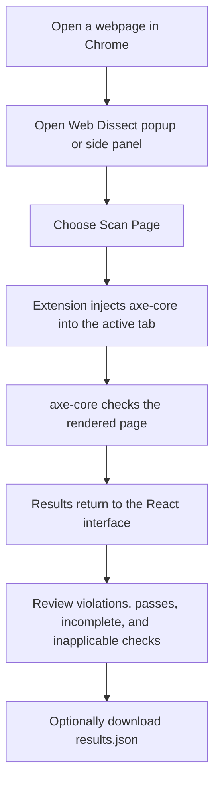

# Web Dissect

Web Dissect is a Chrome extension that checks the currently open webpage for automatically detectable accessibility issues. It runs [axe-core](https://github.com/dequelabs/axe-core) in the page and displays a summary of violations, passes, checks that need manual review, and checks that do not apply.

> **Official Chrome Web Store listing:** [Add the published extension link here](https://chromewebstore.google.com/)
>
> Replace the link above with the extension's direct Chrome Web Store listing URL when it is published.

## What it does

### For anyone using Chrome

1. Open the webpage you want to check.
2. Open Web Dissect from Chrome's Extensions menu or toolbar.
3. Select **Scan Page**.
4. Review the results and use each axe-core rule name and description to investigate issues.
5. Select **Save results.json** to download the complete scan report.

The panel shows counts for violations, passed rules, incomplete checks, and inapplicable checks. Violations are grouped by their axe-core impact (critical, serious, moderate, or minor) and include the rule name and number of affected elements. The panel also lets you copy the active tab's URL and switch between light and dark themes.

**A scan checks the page currently open in the active tab.** Editing the URL field does not navigate to or scan a different page; the field is for viewing or copying a URL.

Automated accessibility tools can only identify some issues. An incomplete check needs a person to review it, and a clean report is not a certification that a page conforms to an accessibility standard. Include manual testing (for example, keyboard and assistive-technology testing) in a complete review.

### How it works (technical overview)

Web Dissect is a Manifest V3 Chrome extension. Its React interface is built with Vite and TypeScript. When you choose **Scan Page**, the extension injects the bundled `axe-core` script into the active tab, runs `axe.run()` against that page, and renders the returned results in the popup or side panel. Results are stored in Chrome's session storage per tab so they can be restored while the browser session remains open.



The extension does not send scan results to a Web Dissect server; the scan is run in the active page and results are handled by the extension in the browser. The extension requests access to HTTP and HTTPS pages so it can inspect pages you choose to scan. Chrome's own pages, extension pages, Chrome Web Store pages, and PDF documents cannot be scanned.

## Install and use

### Install from the Chrome Web Store

Once the extension is published, use the official listing link at the top of this README. Chrome will guide you through adding it and reviewing its requested permissions.

### Install a local build

1. Download or clone this repository and build it (see [Build from source](#build-from-source)).
2. In Chrome, open `chrome://extensions`.
3. Turn on **Developer mode**.
4. Choose **Load unpacked** and select the repository's `dist` folder.
5. Open a webpage you can access and choose the Web Dissect icon from Chrome's Extensions menu. Pin the extension to the toolbar if you want quicker access.
6. Choose **Scan Page** to run the audit.

Chrome shortcuts are also declared for opening the popup and side panel. To see or change the shortcuts available in your Chrome installation, open `chrome://extensions/shortcuts`.

## Build from source

### Requirements

- [Node.js](https://nodejs.org/) 20 LTS or newer
- npm (included with Node.js)
- Google Chrome for loading and testing the extension

### Clone and build

In a terminal:

```bash
git clone https://github.com/Deep0902/Chrome-Extension.git
cd Chrome-Extension
npm ci
npm run build
```

The production extension is generated in `dist/`. Load that folder in Chrome using the steps above. After making changes, run `npm run build` again and choose **Reload** for Web Dissect on `chrome://extensions`.

### Development commands

| Command | Purpose |
| --- | --- |
| `npm run dev` | Start the Vite development server for working on the interface. |
| `npm run build` | Type-check the project and create the production extension in `dist/`. |
| `npm run preview` | Preview the built web interface locally. |
| `npm run lint` | Run ESLint across the project. |

The development server and preview are for interface development; Chrome extension APIs such as active-tab scanning require loading the built extension in Chrome.

## Project structure

| Path | Purpose |
| --- | --- |
| `public/manifest.json` | Chrome extension name, entry points, permissions, shortcuts, and host access. |
| `src/App.tsx` | Main interface, active-tab lookup, scan workflow, and result persistence. |
| `src/components/` | URL field, action buttons, result display, header, theme toggle, and error boundary. |
| `src/background/index.ts` | Extension service worker; handles the side-panel shortcut and debug messages. |
| `src/content/index.ts` | Content-script entry point, currently a small prototype script. |
| `src/hooks/` and `src/lib/` | Theme, URL restrictions, and debug logging helpers. |
| `public/axe.min.js` | Bundled axe-core script injected into the page during a scan. |
| `scripts/copy-axe.mjs` | Utility to copy axe-core from `node_modules` into `public/`. |
| `vite.config.ts` | Builds the popup/side panel, service worker, content script, and static public assets. |

There is no application server or separate backend in the scan workflow.